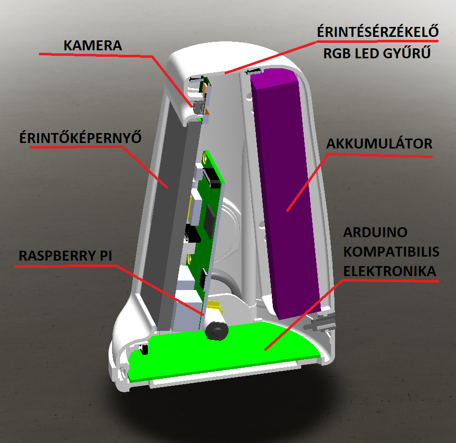

# MiniRobot – Hardver, Mikrokontroller API és ROS 2 Híd Specifikáció

Ez a dokumentum részletezi a MiniRobot alacsony szintű mikrovezérlőjén (Arduino Mega / FreeRTOS) futó firmware működését, a soros JSON kommunikációs protokollt, a szenzorok fizikai konverziós képleteit, valamint a Raspberry Pi-n futó ROS 2 híd (`arduino_bridge.py`) és a Webes Műszerfal (`web_ui`) adatkapcsolatát.

---

# I. RÉSZ: Mikrovezérlő (Arduino / FreeRTOS) Specifikáció és JSON API

A kommunikáció a mikrovezérlő **Serial2 (`USART2`)** portján keresztül történik **115200 baud** sebességgel, soronként (`\n`) lezárt JSON csomagok formájában.

## 1. Beágyazott Rendszerarchitektúra és Működés
A mikrovezérlő szoftvere ([`MiniRobot.ino`](../../MiniRobot/MiniRobot.ino)) egy **FreeRTOS** (Real-Time Operating System) alapú, többszálú rendszer. Ez garantálja, hogy a kritikus feladatok (pl. szakadék- és ütközéselkerülés, motorvezérlés) párhuzamosan és determinisztikus időzítéssel fussanak.

### Főbb FreeRTOS szálak (Tasks):
* **`TaskReceive` (Prioritás 8):** Folyamatosan figyeli a soros portot (`Serial2`), és feldolgozza a Raspberry Pi-től beérkező JSON parancsokat.
* **`TaskMotor` (Prioritás 6):** Kezeli a motorok PWM vezérlését és fix időközönként (100 ms) jelenti a kerék-enkóderek állását.
* **`TaskCliff` (Prioritás 4):** Figyeli a 6 db infra "szakadék" szenzort. Hardveres védelmet valósít meg: ha szakadékot észlel, azonnal felülbírálja a Pi parancsát és megállítja a kerekeket.
* **`TaskBump` (Prioritás 4):** Az első ütközőkapcsolók digitális állapotát figyeli és jelenti.
* **`TaskPwr` (Prioritás 4):** Méri az akkumulátor feszültségét, a külső tápfeszültséget, valamint az áramfelvételt (Raspberry Pi, Arduino és a két motor külön-külön).
* **`TaskLED` (Prioritás 2):** A 14 db-os NeoPixel RGB LED gyűrű vizuális effektjeit és a leállítási folyamatot kezeli.

---

## 2. JSON API Funkciók – Parancsok (Raspberry Pi → Mikrovezérlő)

| Parancs (`cmd`) | Érték (`val`) | Leírás |
| :--- | :--- | :--- |
| `"mot"` | `[int, int]` | Bal és jobb motor PWM értékek. Tartomány: `-90` és `+90` (max `-100..+100`) között. Pl.: `{"cmd":"mot", "val":[50,-50]}` |
| `"ledL"` | `long` | Bal oldali állapotjelző LED-ek színe (Hexadecimális/Long RGB színkód). |
| `"ledR"` | `long` | Jobb oldali állapotjelző LED-ek színe (Hexadecimális/Long RGB színkód). |
| `"pdn"` | `int` | Power Down: A rendszer kikapcsolása a megadott ezredmásodperc várakozás után (pl. `{"cmd":"pdn", "val":5000}`). |

---

## 3. JSON API Funkciók – Telemetria (Mikrovezérlő → Raspberry Pi)

A mikrovezérlő aszinkron módon, a saját FreeRTOS időzítései szerint küldi az alábbi telemetriai csomagokat a Pi felé:

| Parancs (`cmd`) | Érték (`val`) | Leírás és Tömb Sorrend | Gyakoriság |
| :--- | :--- | :--- | :--- |
| `"enc"` | `[long, long]` | Bal és jobb oldali kerék-enkóder kumulált impulzusszáma `[encL, encR]`. | 100 ms |
| `"cliff"` | `[int × 6]` | 3 első és 3 hátsó analóg szakadék-szenzor értéke: `[CF_L, CF_M, CF_R, CB_L, CB_M, CB_R]`. | 100 ms |
| `"bump"` | `[int, int]` | Bal és jobb oldali digitális ütközésérzékelő (`0` vagy `1`): `[BM_L, BM_R]`. | 100 ms |
| `"dist"` | `[int × 4]` | 3 első és 1 hátsó analóg távolságmérő szenzor értéke: `[DF_L, DF_M, DF_R, DB_M]`. | 500 ms |
| `"pwr"` | `[int × 6]` | Tápellátási ADC értékek: `[U_BAT, RS_OP, I_ARD, I_RPI, ML_VP, MR_VP]`. | 100 ms |

---

## 4. Hardveres Biztonsági Logika (Motor Assist)
A mikrovezérlő rendelkezik egy belső **Motor Assist** védelemmel. Ha ez aktív, a robot önállóan megáll, ha:
1. Előre menne (`mot > 0`), de az első szakadékszenzorok (`CF_L`, `CF_M`, `CF_R`) szakadékot látnak.
2. Hátra menne (`mot < 0`), de a hátsó szakadékszenzorok (`CB_L`, `CB_M`, `CB_R`) szakadékot látnak.

Ez a védelem teljesen független a Raspberry Pi-n futó szoftver állapotától, közvetlenül a `TaskCliff`-ben van implementálva.

---

## 5. Szenzor Konverziós Képletek (ADC → Fizikai értékek)

A mikrovezérlő analóg referenciája belső **2.56V**-ra van állítva (`analogReference(INTERNAL2V56)`). Egy 10 bites ADC (0–1023) esetén:
* `1 ADC lépés = 2.56 V / 1023 ≈ 2.502 mV`

A `"pwr"` csomagban érkező `[U_BAT, RS_OP, I_ARD, I_RPI, ML_VP, MR_VP]` nyers (0–1023) értékeket az alábbi hardveres kialakítások alapján kell fizikai mértékegységekre átszámolni:

### 5.1 Rendszer Áramok (`I_ARD` – index 2, `I_RPI` – index 3)
* **Hardveres kialakítás:** Sönt ellenállás (`0.1 Ω`) → feszültség felezés (`1kΩ / 1kΩ`) → Differenciális erősítő (`Gain = 10`, `100kΩ / 10kΩ`).
* **Méréshatár:** 1 A áram esetén az ADC bemenetre pontosan 1 V jut (`U = R * I * G = 0.1 * 1A * 10 = 1V`). A maximális mérhető áram: **2.56 A**.
* **Képlet (Amperre):** `Áram (A) = ADC_érték * (2.56 / 1023.0)`
* **Képlet (mA-re):** `Áram (mA) = ADC_érték * (2.56 / 1023.0) * 1000` *(Kb. `ADC * 2.5`)*

### 5.2 Motor Áramok (`ML_VP` – index 4, `MR_VP` – index 5)
* **Hardveres kialakítás:** Sönt ellenállás (`0.2 Ω`) → Motorvezérlő meghajtó belső erősítése (`Gain = 5`).
* **Méréshatár:** 1 A áram esetén az ADC bemenetre szintén pontosan 1 V jut (`U = 0.2 * 1A * 5 = 1V`). A maximális mérhető áram: **2.56 A**.
* **Képlet (Amperre):** `Áram (A) = ADC_érték * (2.56 / 1023.0)`

### 5.3 Fő Akkumulátor Feszültség (`U_BAT` – index 0, 2S LiPo)
* **Hardveres kialakítás:** Feszültségosztó az OPAMP előtt (`10kΩ` és `2kΩ` ellenállásokkal). Az osztás aránya: `1/6`.
* **Képlet (Voltra):** `Feszültség (V) = ADC_érték * (2.56 / 1023.0) * 6.0` *(Kb. `ADC * 0.015`, max. `15.36 V`)*
* **2S LiPo tartomány a Web UI-on:** `6.6 V` (0% – lemerült) és `8.4 V` (100% – teljesen feltöltött) között skálázódik (6.6 V alatt és 8.4 V felett piros riasztási színnel, közte folyamatos piros → sárga → zöld színátmenettel).

---

## 6. Arduino Fordítási Specifikációk (KRITIKUS)

Ha újra kell fordítani vagy módosítani kell az Arduino programot ([`MiniRobot/MiniRobot.ino`](../../MiniRobot/MiniRobot.ino)), az alábbi Arduino IDE beállításokat szigorúan be kell tartani:

### 6.1 Mikrovezérlő és Pinout (Arduino IDE beállítások)
* **Chip:** A robot egy 100 lábú egyedi `ATmega2560-16AU-TQFP100` chipet használ.
* **Core:** A gyári Arduino Mega csomag nem támogatja a közvetlen AVR lábkiosztást. Telepíteni kell az **MCUdude/MegaCore** board csomagot a *Boards Manager*-ből!
* **Lábkiosztás (Pinout):** A *Tools -> Pinout* menüben **szigorúan az `AVR pinout`** opciót kell kiválasztani! Csak ez a beállítás képes a [`VisiBot_lib.h`](../../MiniRobot/VisiBot_lib.h) fájlban definiált lábkivezetéseket helyesen kezelni. A *Standard 100-pin* opció kiválasztása lefagyasztja a robotot!

### 6.2 Kötelező Könyvtárak (Libraries)
* **Arduino_FreeRTOS** (*Richard Barry*) – A valós idejű taskok ütemezéséhez.
* **ArduinoJson** (*Benoit Blanchon*) – **FONTOS:** Kizárólag a **v6.x.x** verziók valamelyikét telepítsd! A kód a v6-os `StaticJsonDocument` memóriakezelést használja, így a 7-es és újabb verziókkal nem fordul le.
* **Adafruit_NeoPixel** (*Adafruit*) – A 14 db RGB LED vezérléséhez.

### 6.3 Kétirányú Soros Architektúra
Az alaplapon két különálló UART vonal dolgozik egyszerre:
1. **`USART0` (Kódban: `Serial`):** Ez az USB csatlakozó. Kizárólag a szoftver letöltésére (programozás) és debug üzenetek (`Serial.println`) PC felé küldésére szolgál.
2. **`USART2` (Kódban: `USART` / `Serial2`, RX2/TX2 lábak):** Ez van közvetlenül rákötve a Raspberry Pi GPIO 14/15 lábaira. Ez a port továbbítja a valós JSON csomagokat.

---

# II. RÉSZ: ROS 2 – Mikrovezérlő Híd (`minirobot_bringup`) és Web UI Kapcsolat

A Raspberry Pi-n futó [`arduino_bridge.py`](../minirobot_bringup/minirobot_bringup/arduino_bridge.py) csomópont egy kétirányú tolmács, amely a ROS 2 standard topikjait köti össze a mikrovezérlő soros JSON csomagjaival (`/dev/ttyAMA0`, 115200 baud).

## 7. Kimenő Adatok (ROS 2 → Soros JSON)

| ROS 2 Topik | Üzenettípus | Transzformáció | JSON Parancs |
| :--- | :--- | :--- | :--- |
| `/cmd_vel` | `geometry_msgs/msg/Twist` | Differenciálhajtás kinematikai modellje alapján a lineáris (`linear.x`) és szögsebességből (`angular.z`) bal/jobb kerék PWM számítás. | `{"cmd":"mot", "val":[L, R]}` |

### Kinematikai Paraméterek (`arduino_bridge.py`)
* **Keréksugár (`wheel_radius`):** `0.020 m` (20 mm, átmérő: 40 mm)
* **Nyomtáv (`wheel_separation`):** `0.092 m` (92 mm)
* **Enkóder felbontás (`ticks_per_rev`):** `692.0` impulzus / fordulat
* **PWM skálázás (`max_speed_at_100_pwm`):** `0.35 m/s`

---

## 8. Beérkező Adatok (Soros JSON → ROS 2 Topikok)

| JSON Telemetria | Forrás Adat | ROS 2 Topik | Üzenettípus | Felhasználó / Cél |
| :--- | :--- | :--- | :--- | :--- |
| `"pwr"` | `val[0]` (`U_BAT`) | `/battery_state` | `sensor_msgs/msg/BatteryState` | ROS 2 szabványos akkumulátorfeszültség (`voltage` mező Voltban). |
| `"pwr"` | `[U_BAT, RS_OP, I_ARD, I_RPI, ML_VP, MR_VP]` | `/arduino_sensors` | `std_msgs/msg/String` (JSON) | Web UI telemetria (`AKKU fesz`, `RPI áram`, `ARD áram`). |
| `"bump"` | `[BM_L, BM_R]` | `/arduino_sensors` | `std_msgs/msg/String` (JSON) | Web UI ütközésjelző ikonok és diagnosztika. |
| `"cliff"` | `[6× infra érték]` | `/arduino_sensors` | `std_msgs/msg/String` (JSON) | Web UI szakadékjelzők és diagnosztika. |
| `"dist"` | `[4× távolság érték]` | `/arduino_sensors` | `std_msgs/msg/String` (JSON) | Web UI távolságmérő sávok. |
| `"enc"` | `[encL, encR]` | `/odom` | `nav_msgs/msg/Odometry` | Odometria számítás (X, Y pozíció és Theta orientáció). |

---

## 9. Webes Kezelőfelület (`web_ui`) Kétcsatornás WebSocket Architektúrája

A [`web_ui/`](../web_ui/) mappában található böngészős felület ([`index.html`](../web_ui/index.html), [`app.js`](../web_ui/app.js), [`style.css`](../web_ui/style.css)) egyszerre két WebSocket szerverhez csatlakozik:

1. **Arc és Beszédszinkron (`ws://<robot_ip>:8765` – [`face_node.py`](../face_node.py)):**
   * A `/cmd_face` topikra érkező kognitív állapotokat (`READY`, `THINKING`, `SUCCESS`, `CONFUSED`, stb.) és a `/robot_speaking` beszédállapotot továbbítja a böngészőnek, amely valós időben animálja a robot szemeit és száját.
2. **Hardveres Műszerfal és Távirányítás (`ws://<robot_ip>:9090` – `rosbridge_websocket`):**
   * Feliratkozik az `/arduino_sensors`, `/battery_state`, `/from_human` és `/say` topikokra a szenzorok, az akkumulátor állapotjelző csík és a párbeszédablak frissítéséhez.
   * Mozgásvezérlési parancsokat publikál a `/cmd_vel` topikra a virtuális joystick / iránygombok megnyomásakor.
