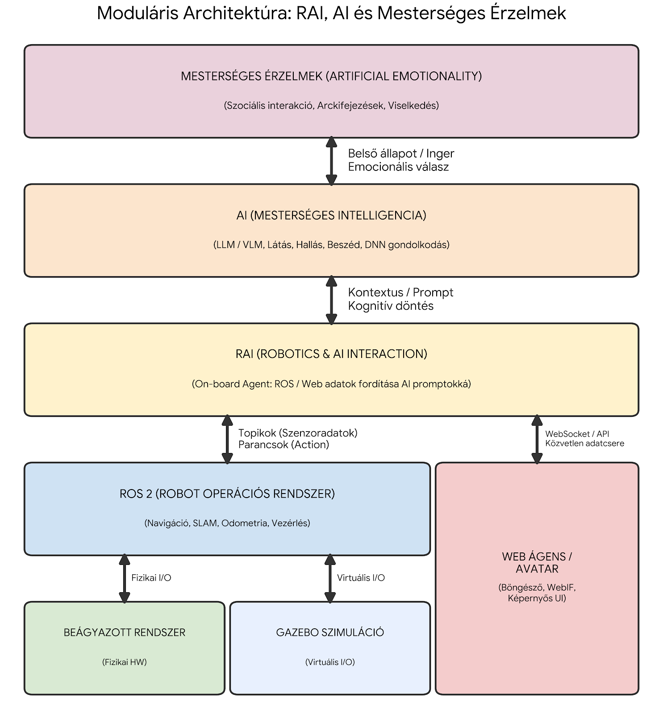

# MiniRobot – AI Integrációs Keretrendszerek, HRI Kognitív Állapotok és Kutatási Koncepció

Ez a dokumentum foglalja össze a MiniRobot mesterséges intelligencia rendszerének elméleti és módszertani alapjait:
* **I. RÉSZ:** A ROS 2 és az Embodied AI integrációs keretrendszerek (RAI, ROSA, ROS-LLM, ROSGPT, TCC-IRoNL) technikai összehasonlítása és gyakorlati példái.
* **II. RÉSZ:** A szociális robotikai (HRI) érzelemmodellek, Paul Ekman alapérzelmei és a MiniRobot által használt kognitív állapotkódok elemzése.
* **III. RÉSZ:** Tudományos kutatási keretrendszer és publikációs stratégia (*Vision-Language-Social Behavior – VLSB*).

---

# I. RÉSZ: ROS 2 és Embodied AI Integrációs Keretrendszerek Elemzése

## 1. Az Alapkoncepció: „Agy” és „Test” szétválasztása

A modern robotikai architektúrában a fizikai végrehajtást és a magas szintű kognitív döntéshozatalt szétválasztjuk:
* **A „Test” (ROS 2):** Az idegrendszer és az izmok. Ez felel azért, hogy a kerekek forogjanak, a kijelzőn megjelenjen az arckifejezés, a szenzorok mérjenek, és a mikrofon vegye a hangot. A ROS 2 determinisztikus, precíz és gyors.
* **Az „Agy” (AI / LLM / VLM):** A gondolkodó réteg. Érti a természetes nyelvű beszédet, feldolgozza a vizuális kontextust, és eldönti, milyen választ vagy arckifejezést adjon a robot.

Az alábbi keretrendszerek azt határozzák meg, hogyan kommunikáljon az **Agy** a **Testtel**.

---

## 2. A Keretrendszerek Technikai Mélyfúrása és Gyakorlati Példái

### 2.1 RAI (Robot Agent Interface) – *RobotecAI* („Az öntudatos robot”)
A RAI nem csupán egy interfész, hanem egy teljes értékű ágens-keretrendszer, amely a robotot „öntudatos” entitássá emeli.
* **Fő feladata:** Olyan magas szintű ügynökök létrehozása, amelyek értik a robot fizikai felépítését és környezetét.
* **Technikai mag:**
  * **Connectors:** Egységesített interfész a ROS 2 topikokhoz, szolgáltatásokhoz (`services`) és akciókhoz (`actions`).
  * **RAI_whoami:** URDF fájlokból és dokumentációkból egy **RAG (Retrieval-Augmented Generation)** adatbázist épít. Ha megkérdezed tőle: *„Átférsz a széklábak között?”*, a RAI megnézi a saját műszaki rajzát, és válaszol: *„Nem, mert 20 cm széles vagyok, a rés pedig csak 15 cm.”*
* **Vizuális integráció:** Natív támogatás a multimodális (VLM) modellekhez.
* **MiniRobot Példa:** Az AI ágens tudja, hogy van egy kijelzője és beszédszintetizátora. Ha a felhasználó kérdez valamit, a válasz szövegével együtt kiválasztja a megfelelő kognitív állapotkódot (pl. `[AFFECTION]` vagy `[SUCCESS]`), amely vezérli a robot arcát.

### 2.2 ROSA (Robot Operating System Agent) – *NASA JPL* („A technikai asszisztens”)
A NASA JPL által fejlesztett diagnosztikai ágens ROS rendszerekhez.
* **Fő feladata:** Rendszerdiagnosztika, monitorozás és operátori támogatás természetes nyelven.
* **Technikai mag:** **LangChain** alapú **ReAct (Reasoning + Acting)** ciklus. A ROSA a ROS parancssori eszközeit (`ros2 node list`, `ros2 topic echo`) használja eszközként (*Tool*).
* **MiniRobot Példa:** *„ROSA, miért nem mozog a robot?”* → *„A `/cmd_vel` topiknak nincs feliratkozója, valószínűleg az `arduino_bridge` csomópont leállt.”*

### 2.3 ROS-LLM (*Huawei Noah's Ark Lab*) („A szigorú programszervező”)
Ipari szintű megoldás, amely a determinisztikus viselkedésre és a biztonságos programozhatóságra fókuszál.
* **Fő feladata:** Természetes nyelvű utasítások fordítása strukturált robotprogramokká.
* **Technikai mag:** Az LLM nem közvetlenül irányít, hanem **Behavior Trees (BT)** (Viselkedési Fák) generálását végzi, ami garantálja, hogy a robot logikája átlátható és biztonságos maradjon. Támogatja az *Imitation Learning* megoldásokat is.
* **MiniRobot Példa:** Egy összetett feladatnál (*„Keresd meg a gazdádat és köszönj neki”*) fix sorrendet épít fel: 1. Forogj körbe → 2. Ha látsz embert, menj oda → 3. Állj meg → 4. `set_emotion(SUCCESS)` → `say("Szia!")`.

### 2.4 ROS-LLM (*Auromix*) („A plugin-mester”)
Közösségi fejlesztésű, könnyűsúlyú alternatíva gyors prototipizáláshoz.
* **Fő feladata:** Gyors LLM integráció meglévő ROS 2 robothoz.
* **Technikai mag:** **Reasoning–Action–Observation** hurok lokális memóriával és plugin-rendszerrel, közvetlen ROS Action/Service hívásokkal.

### 2.5 ROSGPT és ROSGPT Vision („A parancs-fordító és a robot szemei”)
* **ROSGPT:** Tiszta **Szemantikus Parser**. A természetes nyelvű mondatból (*„Fordulj balra 90 fokot!”*) strukturált JSON objektumot (`{"action": "rotate", "angle": 90}`) állít elő.
* **ROSGPT Vision:** Bevezeti a **Prompting Robotic Modalities (PRM)** mintát két lépésben:
  1. A VLM elemzi a kameraképet (*Visual Prompt*).
  2. Az LLM összeveti a látványt a feladattal, és dönt a végrehajtásról.

### 2.6 TCC-IRoNL (*The Conversation is the Command*) („A vizuális navigátor”)
Kutatási fókuszú, látvány-központú navigációs keretrendszer.
* **Fő feladata:** Interaktív navigáció és a vizuális kétértelműség (*visual ambiguity*) feloldása az LLM és a VLM szinergiájával.
* **Példa:** *„Menj a piros székhez!”* → A VLM azonosítja a képen a három szék közül a pirosat, és a koordinátáit átadja a navigációs modulnak.

---

## 3. Összehasonlító Mátrix és MiniRobot Stratégia

| Keretrendszer | Logikai alap | Elsődleges cél | Számítási igény | Mikor válaszd? |
| :--- | :--- | :--- | :--- | :--- |
| **RAI** | Agentic / RAG / ReAct | Öntudatos, multimodális ágens | Magas (Cloud / NPU) | Ha a robotnak „személyiséget” és komplex HRI képességeket adunk |
| **ROSA** | ReAct + CLI Tools | Diagnosztika | Közepes | Ha a robotnak el kell mondania, mi romlott el benne |
| **ROS-LLM (Huawei)** | Behavior Trees | Strukturált programozás | Magas | Ipari pontosságú, többlépcsős biztonságos feladatsorokhoz |
| **ROS-LLM (Auromix)** | Plugins | Gyors integráció | Alacsony | Gyors prototipizáláshoz és plugin-alapú bővítéshez |
| **ROSGPT (Vision)** | Semantic Parsing / PRM | Parancsközlés és látás | Alacsony–Közepes | Egyszerű hangvezérelt navigációhoz és tárgyfelismeréshez |
| **TCC-IRoNL** | LLM + VLM Grounding | Vizuális navigáció | Magas (GPU) | Dinamikus környezetben végzett tárgyalapú navigációhoz |

### A MiniRobot Hibrid Architektúrája
1. **Test (ROS 2 Jazzy + Arduino FreeRTOS):** A valós idejű szenzoradat-gyűjtés, biztonsági szakadékfigyelés és differenciálhajtás.
2. **Döntéshozó (RAI ReAct Ágens – `agent.py`):** A központi Python csomópont, amely a felismert beszéd (`/from_human`) alapján gondolkodik, és egyszerre vezérli a beszédszintézist (`/to_human`) és a robot vizuális érzelmi állapotát (`/cmd_face`).
3. **Kifejezés és Diagnosztika (`face_node.py` + `web_ui`):** WebSocket-alapú interaktív arc és valós idejű telemetriai műszerfal.

---

# II. RÉSZ: Robot Érzelmek és HRI Kognitív Állapotok Elemzése

Ebben a fejezetben összehasonlítjuk a MiniRobot vizuális kifejezőképességeit, a pszichológiai alapérzelmeket és a modern szociális robotika (HRI – *Human-Robot Interaction*) által preferált kognitív állapotokat.

## 4. Összehasonlító Táblázat: Kognitív Állapotok vs. Ekman Alapérzelmek

| MiniRobot Állapotkód | HRI Kognitív Állapot | Ekman Alapérzelem | Gyakorlati Funkció az AI Asszisztensnél |
| :--- | :--- | :--- | :--- |
| **`READY`** | Idle / Listening | (Neutral) | Alapállapot, figyelem, miközben a VAD hallgatja az embert |
| **`THINKING`** | Processing | – | Az LLM épp generálja a választ a háttérben (Néma gondolkodás, automatikusan aktiválódik kérdés beérkezésekor) |
| **`CONFUSED`** | Misunderstood | – | Nem hallotta jól a beszédet, vagy az AI nem tudja értelmezni a kérést |
| **`SUCCESS`** | Triumph / Task Done | Öröm (*Joy*) | Egy parancs vagy feladat sikeres végrehajtása |
| **`SORRY`** | Apologetic / Failure | Szomorúság (*Sadness*) | Hiba történt, vagy az AI nem tud információt szolgáltatni |
| **`ALERT`** | System Error / Warning | Félelem (*Fear*) / Harag | Kritikus hiba, akadály, vagy rendszerfigyelmeztetés |
| **`CURIOSITY`** | Seeking Info / Attention | Meglepettség (*Surprise*) | Visszakérdezés, új információra vagy emberre való rácsodálkozás |
| **`OBSERVING`** | Tracking | – | Kamera alapú tárgy- vagy arckövetés jelzése |
| **`AFFECTION`** | Empathy | (Öröm / Szeretet) | Pozitív, barátságos visszacsatolás a felhasználónak (pl. *„Köszönöm!”*) |
| **`WINK`** | Social Engagement | – | Lazább, emberi jellegű interakció (*easter egg*, humor, kacsintás) |

---

## 5. Miért Kognitív Állapotokat használunk Biológiai Érzelmek helyett?

### A) Paul Ekman 6 Alapérzelme (Biológiai/Pszichológiai modell)
1. **Öröm (*Joy*):** Jól konvertálható robotikába (`SUCCESS`, `AFFECTION`).
2. **Szomorúság (*Sadness*):** Hasznos a sajnálat kifejezésére (`SORRY`).
3. **Félelem (*Fear*):** Egy asszisztens robotnál ritkán természetes, de az `ALERT` (riadó/veszély) funkcióhoz hasonlítható.
4. **Harag (*Anger*):** Általában elkerülendő szociális robotoknál.
5. **Meglepettség (*Surprise*):** Hasznos visszajelzés, a `CURIOSITY` felel meg neki.
6. **Undor (*Disgust*):** Egy gépnél értelmezhetetlen, ezért a robotikában nem implementálják.

### B) Kognitív Állapotok (HRI modell)
A modern szociális robotoknál (pl. Anki Cozmo, Vector, Jibo) a robotnak a saját **belső, számítógépes feldolgozási folyamatait** (*Processing, Error, Task Done*) kell emberi formába öntenie, hogy a felhasználó azonnal értse, mi történik a gépben:
* Amint a felhasználó befejezi a beszédet, az `agent.py` azonnal `THINKING` állapotba kapcsolja az arcot, így a felhasználó látja, hogy a robot hallotta a kérdést és dolgozik a válaszon.
* Amikor az LLM válaszol, a válasz legelső tokenjeként szögletes zárójelben (pl. `[SUCCESS]`, `[CURIOSITY]`, `[SORRY]`) küldi el a kognitív állapotkódot, amelyet a `tts_node.py` kiszűr a szövegből: a címkét továbbítja a `/cmd_face` topikra, a tiszta szöveget pedig felolvassa a Piper TTS-sel.

---

# III. RÉSZ: Tudományos Kutatási Keretrendszer (VLSB / VLSA)

**Szerző / Affiliáció:** Dr. Burkus Ervin, Óbudai Egyetem (ÓE)  
**Téma:** Alacsony költségvetésű asszisztens robot proaktív vezérlése VLM/LLM modellekkel

---

## 6. A Kutatási Alaphelyzet és a Piaci Rés (*The Missing Middle*)

A szerviz- és asszisztensrobotok piaca jelenleg két szélsőség között polarizálódik:
* **Alsó kategória (~$100):** Funkcionálisan korlátozott asztali játékok.
* **Felső kategória ($60,000+):** Drága, komplex humanoid platformok.

### A Fejlesztett Hardverplatform Specifikációi:
* **Fizikai paraméterek:** Gazdaságilag optimális (~$300-os árszint), ~30 cm magas kompakt felépítés.
* **Architektúra:** Raspberry Pi 5 (ROS 2 Jazzy + RAI) és ATmega2560 (FreeRTOS) hibrid alapok.
* **Szenzorozottság:** Kamera, mikrofon, hangszóró, 800×480 LCD érintőkijelző az avatar és a diagnosztika számára, ultrahangos/optikai távolságmérők, infra szakadékfigyelők és ütközésszenzorok.
* **Mozgás és Kifejezés:** Differenciálhajtású kerekek. A robotnak **nincs fizikai manipulátora (keze/megfogója)** – a szociális interakciókat, az expresszivitást és a helyváltoztatást a differenciálhajtás mikromozgásai, az LCD avatar kognitív mimikája és a beszéd közvetítik.

---

## 7. Tudományos Nóvum és Terminológia (VLSB / VLSA)

Míg a szakirodalomban létező **VLA (*Vision-Language-Action*)** modellek (pl. RT-2, OpenVLA) a robotkarok fizikai manipulációjára fókuszálnak, ezen a platformon a fókusz a **szociális interakcióra és a proaktív jelenlétre** helyeződik:
1. **VLSB:** *Vision-Language-Social Behavior*
2. **VLSA:** *Vision-Language-Social Actions*

### A Központi Kutatási Kérdés:
> *Hogyan képes egy multimodális nagy nyelvi modell (VLM/LLM) a fizikai megtestesülés (embodiment) által egy passzív interfészből **aktív, proaktív szociális ágenssé** válni egy korlátozott hardverű, karok nélküli mobil roboton?*

### Kulcsfogalmak:
* **Interakciós Szemantika:** A VLM a környezetből (*Vision*) és a beszédből (*Language*) származó kontextust közvetlenül a robot testbeszédére (orientáció, mikromozgások) és az LCD avatar kognitív állapotaira képezi le.
* **Socially Aware Proactivity (Társadalmilag tudatos proaktivitás):**
  1. *Passzív mód (Passive Mode):* Csendben észlel és kontextust épít.
  2. *Készenléti mód (Ready Mode):* Proaktív pozicionálás a felhasználó látóterében a mozgási útvonal akadályozása nélkül.
  3. *Aktív mód (Active Mode):* Expresszív, kontextusfüggő kezdeményezés.
* **Spatial Awareness & Shared Physical Context:** Fizikai tér megosztása az emberrel, odafordulás és odagurulás a hivatkozott tárgyakhoz/személyekhez (*Physical Grounding*).

---

## 8. Edge-Cloud Hibrid Rendszerarchitektúra és Validációs Terv

1. **Reflexive Layer (Lokális Mikrokontroller + Raspberry Pi):** Alacsony késleltetésű (*low-latency*) azonnali reakciók (szakadék- és ütközéselkerülés, VAD beszédészlelés, lokális Piper TTS, helyi vizuális követés).
2. **Cognitive Layer (Cloud API – Gemini / Groq Whisper):** Magas szintű helyzetértékelés, szemantikai elemzés és párbeszéd-generálás.
3. **Social Expression Layer (Lokális HRI):** A felhőből érkező válasz és kognitív állapotkód lefordítása szinkronizált beszédre, szájmimikára, szemanimációra és kerékmozgásra.

### Validációs Pillérek:
1. **Ablation Study:** A kognitív állapotkijelzés és a VLM kontextus-megértés hatásának mérése.
2. **User Study:** Felhasználói kísérletek a fizikai megtestesüléssel rendelkező robot és a statikus képernyős asszisztens összehasonlítására.
3. **Edge-Cloud Benchmark:** Az ASR → LLM → TTS csővezeték késleltetésének (*latency*) és a helyi reflexív réteg válaszidejének mérése.
